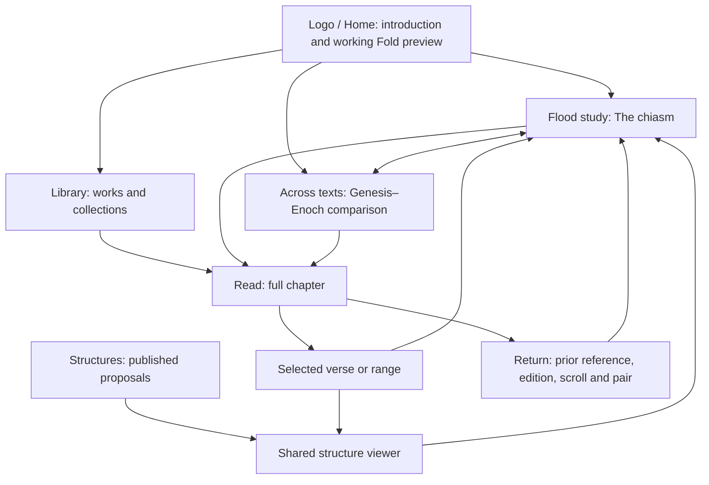

# ChiFold route map

ChiFold keeps its existing query-string router and browser history. The shared shell contains Library, Read and Structures, plus the logo (home) and a single Go to passage form. The current destination is marked with `aria-current="page"`, heavier type and an underline on desktop and mobile. Home is an editorial introduction at `/`, with no top-level destination marked active. The featured Flood study remains at its dedicated query-string URL under Structures.

| Screen | Example route |
| --- | --- |
| Homepage / working preview | `/` |
| Library | `?view=library&collection=all` |
| Read (fresh starting place) | `?view=reader` (Genesis 1; resumes the existing reference during app navigation) |
| Chapter | `?view=reader&work=genesis&chapter=7&edition=kjv` |
| Verse / range | `?view=reader&work=genesis&chapter=7&verse=19&end=20&edition=kjv` |
| Structures index | `?view=structures` |
| Specific Flood study + pair | `?view=chiasm&structure=wenham-flood&pair=mountains` |
| Independent Enoch proposal | `?view=chiasm&structure=domka-watchers&pair=domka-turn` |
| Enoch 9 sequential outline | `?view=chiasm&structure=domka-enoch-9` |
| Across texts within that study | `?view=trace&structure=wenham-flood&pair=mountains` |

Generated links also carry `preferred`, `structure` and `pair`, keeping a reading preference separate from the displayed `edition`. Library links carry `collection`. Old `?pair=…` and `?view=trace` links still open the Flood study. Unknown or citation-only structure IDs go to Structures; invalid explicit passage references go to Library instead of guessing another passage. Every working catalogue proposal uses this same route/viewer contract. Across texts remains specific to the existing Flood study.

The homepage's 40-day and 150-day choices are local preview state. Both study actions encode that choice in the existing `view=chiasm&structure=wenham-flood&pair=…` URL, supporting keyboard activation, copying and new tabs. Home links back to `/`; the edition preference remains in the reader and local storage. The preview uses three real pair groups and the proposed center from the full Wenham file. It does not change that file or the full study workspace.

The chiasm and Across texts are local study views, not top-level destinations. Collection filters stay in Library; edition controls stay near the text. Go to passage opens the same full-chapter reader from any screen. The top-level links support normal new-tab and copy-link behavior.

Within a tab, navigation records bookmarks in the existing reducer and browser history. Return restores the previous reference/range, edition, preference, scroll, proposal ID and selected correspondence. A fresh shared URL restores its encoded location and selection; it does not invent the sender's navigation history. Browser Back/Forward and reload use the existing history-state restoration.

## Edit the navigation

- `src/components/AppHeader.tsx`: shared logo and top-level destinations.
- `src/components/HomeView.tsx`, `FloodPreview.tsx`, and `src/home.css`: homepage composition and working preview. `src/lib/floodPreview.ts` selects existing source pairs and their published boundaries.
- `src/App.tsx`: screen composition, local study tabs and shared passage lookup.
- `src/components/StructuresView.tsx`: searchable/paged working catalogue and separate citation-only leads.
- `src/components/StructureStudy.tsx`: shared proposal viewer; `ReaderStructures.tsx` exposes the same evidence from a chapter.
- `src/lib/routes.ts`: route serialization, parsing and destination classification.
- `src/hooks/useReadingLocation.ts`: browser history and navigation actions.
- `src/lib/reader.ts`: bookmark/return transitions.
- `src/styles.css`, **App navigation shell**: header layout and destination marker. Shared typography and palette tokens remain at the top of the file.

## Verification

`tests/routes.test.ts` covers chapter/verse/structure URL round-trips, legacy URLs, destination classification, bare Read, invalid references and Library collection URLs. `tests/structures.test.ts` covers all generated map files, source accounting, independent proposals, multi-proposal URLs and return restoration. Existing tests retain edition, collection and scroll checks. The corpus and Church-list collection are unchanged; the source-backed proposal catalogue is new.
